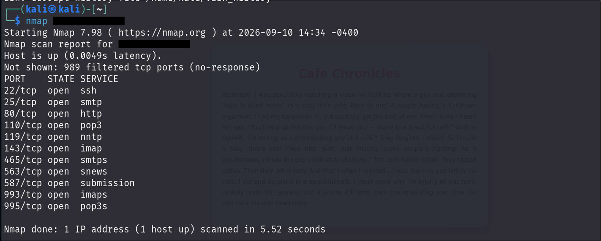
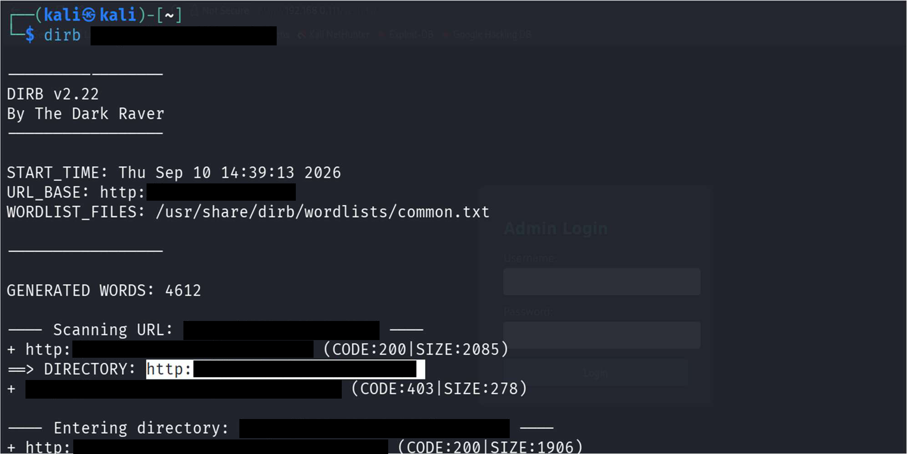
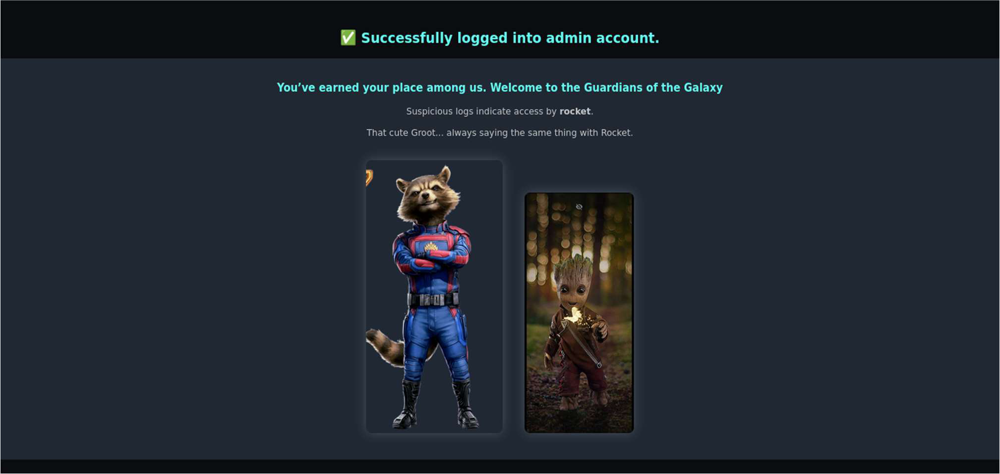
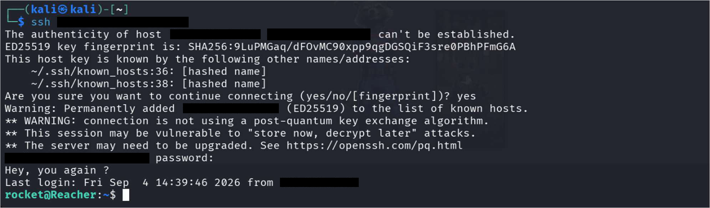
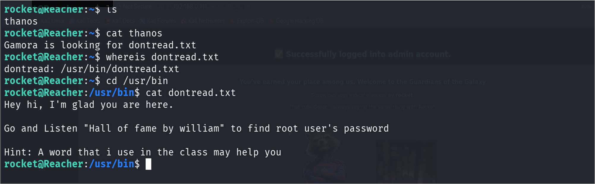
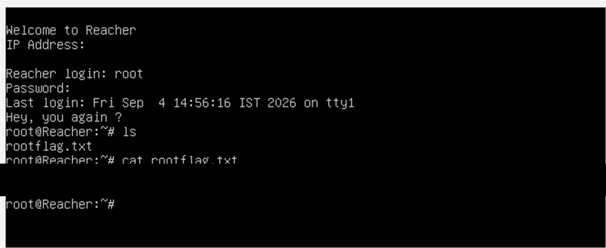

# SQL-Injection-
Authentication Bypass in the Admin Login at /secrets/
# Reacher Machine – CTF Walkthrough

## Overview

This repository documents my assessment of the **Reacher** machine. The main finding was an **SQL Injection vulnerability** in the Admin Login page under `/secrets/`. The authentication bypass exposed clues that led to SSH access and, later, root-level access.

> **Lab-use note:** This write-up is based on a controlled CTF/lab exercise. IP addresses have been redacted from the screenshots. Account passwords and the root flag are intentionally omitted from this public version.

## Vulnerability Details

| Item | Details |
|---|---|
| Vulnerability | SQL Injection – Authentication Bypass |
| Affected location | `/secrets/` – Admin Login |
| CVSS | **9.8 – Critical (CVSS v3.1)** |
| Vector | `CVSS:3.1/AV:N/AC:L/PR:N/UI:N/S:U/C:H/I:H/A:H` |
| Impact | Admin-panel access, SSH access, and root-level compromise |

## Assessment Summary

### 1. Identify open services

I performed an Nmap scan against the target to identify open ports and running services.

The report recorded these open TCP ports:

- `22` – SSH
- `25` – SMTP
- `80` – HTTP
- `110` – POP3
- `119` – NNTP
- `143` – IMAP
- `465` – SMTPS
- `563` – SNEWS
- `587` – Submission
- `993` – IMAPS
- `995` – POP3S

### 2. Directory enumeration

I used DIRB to enumerate directories and files on the web server. During enumeration, I discovered `secrets.txt` and the `/secrets/` directory, which contained the Admin Login page.

### 3. Locate the Admin Login page

I opened the discovered `/secrets/` resource and identified the Admin Login form.

### 4. SQL Injection – Authentication Bypass

I tested the username field for SQL Injection. The input was interpreted as part of the application's authentication query, allowing the login control to be bypassed without valid administrator credentials.

The application displayed:

**“Successfully logged into admin account.”**

This confirmed access to the Admin Panel.

### 5. Obtain SSH access

The Admin Panel contained clues that revealed credentials for the `rocket` account. I used the discovered account details to establish an SSH session with the Reacher machine.

**Credential values are intentionally redacted in this public write-up.**

### 6. Privilege escalation to root

After obtaining SSH access, I examined additional clues on the machine. One clue referred to listening to the song **“Hall of Fame” by will.i.am**. The hint indicated that a word used in class would help identify the root user's password.

Using the clue, I obtained root-level access and accessed `rootflag.txt`.

**The root password and flag value are intentionally not published.**

## Impact

The SQL Injection vulnerability allowed an attacker to bypass the Admin Login and gain unauthorized access to the Admin Panel. Information exposed in the panel led to SSH access through the `rocket` account. Further enumeration enabled root-level access.

Root access provided full control over the server and access to sensitive files. An attacker could potentially read, modify, or delete data, change system configurations, create unauthorized accounts, or disrupt services.

Overall, this vulnerability chain could result in complete compromise of the Reacher machine.

## Remediation

1. Use **parameterized queries** or **prepared statements** to prevent SQL Injection.
2. Implement proper input validation for all user-supplied data.
3. Use strong, unique passwords and securely hash stored passwords.
4. Restrict SSH access and enforce the principle of least privilege for user accounts.
5. Protect sensitive files and information, and perform regular security testing.

## Key Learning Outcomes

- Identified open services using Nmap.
- Enumerated web directories using DIRB.
- Identified and demonstrated SQL Injection in a login form.
- Understood how an authentication bypass can expose further access paths.
- Practiced SSH access and Linux privilege-escalation investigation.
- Reviewed the impact and remediation of a chained vulnerability.

---

**Machine:** Reacher  
**Category:** CTF / Web Application Security  
**Primary vulnerability:** SQL Injection  
**Tools mentioned in the report:** Nmap, DIRB, SSH
